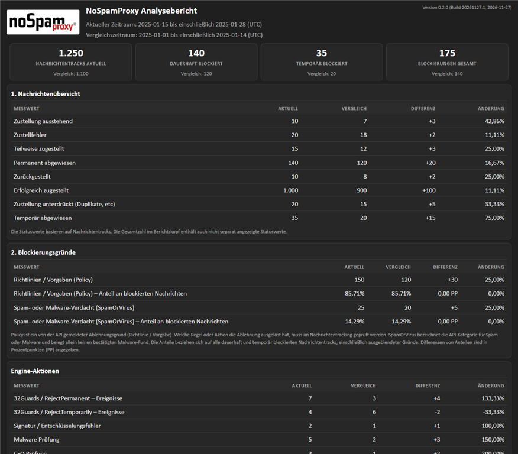

# NoSpamProxy BlockReport Next

**Ein kompakter PowerShell-Analysebericht für NoSpamProxy.** Alle Daten werden lesend über die OData-Service-API abgerufen – ohne SQL-Zugriff.

<p align="center">
  
  <br>
  <sub>Berichtsvorschau mit fiktiven Beispieldaten.</sub>
</p>

<p align="center">
  <a href="https://github.com/sbe-nsp/NoSpamProxy-BlockReportNext/releases/tag/v0.2.0">Release 0.2.0</a> ·
  <a href="#api-zugang-erstellen">API-Zugang erstellen</a> ·
  <a href="#installation">Installation</a> ·
  <a href="#aufruf">Aufruf</a> ·
  <a href="#wöchentliche-ausführung-mit-der-aufgabenplanung">Aufgabenplanung</a>
</p>

## API-Zugang erstellen

Der Bericht benötigt einen NoSpamProxy-API-Schlüssel, auch Personal Access Token (PAT) genannt, mit genau zwei Leserechten:

- `read:messageTracking` für die Nachrichtentracking-Daten einschließlich URL Safeguard.
- `read:ownedDomains` für die eigenen Domains und die Auswertung interner Empfänger.

`manage`-Rechte sind für den Bericht nicht erforderlich. Zum **Erstellen** des Schlüssels benötigst du ein NoSpamProxy-Benutzerkonto, das API-Schlüssel erstellen darf.

### 1. PowerShell öffnen

Melde dich an einem NoSpamProxy-System an, auf dem das NoSpamProxy-PowerShell-Modul installiert und eingerichtet ist. Öffne über das Windows-Startmenü **Windows PowerShell**. Gib die folgenden Befehle in diesem Fenster ein und bestätige jeden Befehl mit **Enter**. Das Fenster während der Einrichtung geöffnet lassen.

### 2. NoSpamProxy-Modul laden

```powershell
Import-Module NoSpamProxy
```

Wird das Modul nicht gefunden, muss es zuerst auf diesem System verfügbar gemacht werden; wende dich dazu an die NoSpamProxy-Administration.

### 3. Mit NoSpamProxy verbinden

```powershell
Connect-Nsp -Credential (Get-Credential)
```

Im Anmeldefenster den Benutzernamen und das Passwort des NoSpamProxy-Kontos eingeben und bestätigen. Wenn die Verbindung wegen eines nicht vertrauenswürdigen Serverzertifikats fehlschlägt, kann in einer Testumgebung alternativ folgender Befehl verwendet werden:

```powershell
Connect-Nsp -IgnoreServerCertificateErrors -Credential (Get-Credential)
```

Der Schalter überspringt die Zertifikatsprüfung; für produktive Umgebungen sollte stattdessen ein vertrauenswürdiges Zertifikat verwendet werden.

### 4. API-Schlüssel erstellen und bereitstellen

Nach erfolgreicher Anmeldung diesen Befehl ausführen:

```powershell
$reportKey = New-NspApiKey -Name "NoSpamProxy-BlockReport" -Permissions "read:messageTracking","read:ownedDomains"
```

Der Name muss für dein Benutzerkonto eindeutig sein. Falls bereits ein Schlüssel mit diesem Namen existiert, wähle einen anderen Namen. Der Tokenwert wird nur bei der Erstellung zurückgegeben. Um den API-Schlüssel als Text auszugeben und beispielsweise für die Aufgabenplanung zu übernehmen, führe im selben Fenster aus:

```powershell
Write-Output $reportKey.Token
```

Kopiere den angezeigten Schlüssel direkt in einen geschützten Secret Store. Nach dem Schließen des Fensters kann der Tokenwert nicht erneut über NoSpamProxy abgerufen werden; bei Verlust muss ein neuer Schlüssel erstellt werden. Die [Anleitung zur Aufgabenplanung](#wöchentliche-ausführung-mit-der-aufgabenplanung) zeigt, wie ein gespeicherter Schlüssel für eine wöchentliche Ausführung bereitgestellt wird.

Den Schlüssel für den Bericht in **demselben PowerShell-Fenster** bereitstellen:

```powershell
$env:NSP_API_KEY = $reportKey.Token
```

Die Variable gilt nur für dieses PowerShell-Fenster. Nach dem Schließen muss der Schlüssel für einen erneuten Aufruf wieder bereitgestellt werden. Wie ein bereits vorhandener Schlüssel eingegeben wird, steht unter [Zugangsdaten](#zugangsdaten).

### 5. Bericht ausprobieren

Das [Anwenderpaket installieren](#installation), falls noch nicht geschehen. Im selben PowerShell-Fenster in das entpackte Verzeichnis wechseln. Den Beispielpfad durch den tatsächlichen Pfad ersetzen:

```powershell
Set-Location 'C:\Pfad\zum\NoSpamProxy-BlockReport'
```

Die eigene HTTPS-Basis-URL der NoSpamProxy-Service-API eingeben und den Bericht ohne E-Mail-Versand erstellen:

```powershell
$odataBaseUrl = Read-Host 'HTTPS-Basis-URL der eigenen NoSpamProxy-Service-API'
$outputPath = Join-Path $env:TEMP ("NoSpamProxy-Report-{0}.html" -f (Get-Date -Format 'yyyyMMdd-HHmmss'))
.\Get-PermanentlyBlocked.ps1 -ODataBaseUrl $odataBaseUrl -NoSend -ReportType HTML -OutputPath $outputPath
```

Nach erfolgreichem Abschluss zeigt PowerShell den Speicherort der HTML-Datei an. Mit diesem Befehl lässt sich der Bericht im Browser öffnen:

```powershell
Start-Process $outputPath
```

## Berichtsumfang

Der Bericht vergleicht dieselben neun Bereiche in zwei vollständigen, nicht überlappenden 14-Tage-Zeiträumen:

1. Verarbeitete Nachrichtentracks und Zustellstatus
2. Blockierungsgründe, Filterereignisse und Engine-Aktionen
3. ContentFiltering-Ereignisse und Anhang-Quarantäne
4. MalwareScan-Operationen und bestätigte Malware-Funde
5. Sandbox-Analyse
6. URL Safeguard
7. 32GUARDS Recall
8. 32Guards DeepFile Analyzer
9. Häufigste MIME-Typen und Status der zugehörigen Nachricht

Zusätzlich enthält der Bericht weiterhin eine Top-10-Liste interner Empfänger dauerhaft oder temporär blockierter Nachrichten. Wo die API eine periodische Kennzahl nicht belegt, zeigt der Report `n/a` und erklärt die Einschränkung. Erfolgreich abgefragte Nullwerte werden als `0` dargestellt. Prozentänderungen bei einem Vergleichswert von null sind nicht berechenbar und erscheinen als `n/a`.

Differenzen zwischen Anteilen werden als Prozentpunkte (`PP`) ausgewiesen; die Spalte „Änderung“ zeigt die relative Veränderung. Die Blockierungsgründe `LoopDetected` und `None` werden nicht als Zeilen angezeigt, zählen aber weiterhin zum Nenner der Anteile. Filtertreffer werden kompakt als Ereignisse mit positiver Bewertung gezeigt; sie belegen für sich keine ursächliche Blockierung.

`Policy` ist ein API-Ablehnungsgrund, der als „Richtlinie / Vorgabe“ übersetzt wird. Der Wert allein nennt weder die konkrete Regel noch die auslösende Aktion; diese lassen sich im Nachrichtentracking prüfen. `SpamOrVirus` allein belegt keinen bestätigten Malware-Fund.

Die MIME-Typen lassen sich im HTML-Bericht einzeln aufklappen und sind zunächst geschlossen. Im PDF sind ihre Details vollständig geöffnet; die Darstellung in E-Mail-Programmen hängt von deren Unterstützung für aufklappbare Bereiche ab.

Die Zeitfilter sind UTC: aktueller Zeitraum `[heute-14 Tage, heute)`, Vergleichszeitraum `[heute-28 Tage, heute-14 Tage)`. Start ist inklusiv, Ende exklusiv.

## Voraussetzungen

- Windows und PowerShell 5.1 oder neuer.
- HTTPS-Zugriff auf die NoSpamProxy-Service-API und die eigene Basis-URL.
- Ein PAT mit `read:messageTracking` und `read:ownedDomains`.
- Für PDF-Ausgabe: Microsoft Edge. Ohne Edge wird beim Versand HTML als Fallback verwendet.
- Für den Versand: erreichbarer SMTP-Relay auf Port 25, gültiger Absender und Empfänger.
- `template.html` und `ReportOData.ps1` im selben Verzeichnis wie `Get-PermanentlyBlocked.ps1`.
- Das NoSpamProxy-Logo ist in `template.html` eingebettet; eine separate Bilddatei ist nicht erforderlich.

## Installation

Das [Anwenderpaket](https://github.com/sbe-nsp/NoSpamProxy-BlockReportNext/releases/download/v0.2.0/NoSpamProxy-BlockReportNext-v0.2.0-build20261127.1.zip) herunterladen und entpacken. Es enthält nur `Get-PermanentlyBlocked.ps1`, `ReportOData.ps1`, `template.html` und diese README.

Alternativ den `master`-Branch klonen:

```powershell
git clone --branch master https://github.com/sbe-nsp/NoSpamProxy-BlockReportNext.git
Set-Location .\NoSpamProxy-BlockReportNext
```

Die Dateien im Projektverzeichnis zusammen belassen. Danach den PAT wie unter [API-Zugang erstellen](#api-zugang-erstellen) beschrieben bereitstellen und den Bericht zunächst mit `-NoSend` prüfen.

## Zugangsdaten

Der PAT wird ausschließlich aus der Prozess-Umgebungsvariable `NSP_API_KEY` gelesen. Lege ihn nicht in Skriptdateien, Aufgabenargumenten, PowerShell-History, Logs oder Git ab. Für geplante Ausführungen sollte ein geschützter Secret Store den Wert zur Laufzeit in die Umgebung des Prozesses laden.

Wenn bereits ein PAT vorhanden ist, kann er für einen interaktiven Test verdeckt abgefragt werden:

```powershell
$odataBaseUrl = Read-Host 'HTTPS-Basis-URL der eigenen NoSpamProxy-Service-API'
$securePat = Read-Host 'NoSpamProxy PAT' -AsSecureString
$pointer = [Runtime.InteropServices.Marshal]::SecureStringToBSTR($securePat)
try {
    $env:NSP_API_KEY = [Runtime.InteropServices.Marshal]::PtrToStringBSTR($pointer)
    .\Get-PermanentlyBlocked.ps1 -ODataBaseUrl $odataBaseUrl -NoSend -OutputPath "$env:TEMP\NoSpamProxy-Report.html"
}
finally {
    Remove-Item Env:\NSP_API_KEY -ErrorAction SilentlyContinue
    [Runtime.InteropServices.Marshal]::ZeroFreeBSTR($pointer)
}
```

## Aufruf

Die ausführliche Hilfe lässt sich ohne API-Schlüssel oder Berichtserstellung anzeigen:

```powershell
.\Get-PermanentlyBlocked.ps1 -Help
# Alternativ:
Get-Help .\Get-PermanentlyBlocked.ps1 -Full
```

HTML-Bericht erstellen, ohne eine E-Mail zu senden:

```powershell
.\Get-PermanentlyBlocked.ps1 -ODataBaseUrl 'https://nospamproxy.example.com' -NoSend -OutputPath 'C:\Reports\NoSpamProxy-Report.html'
```

HTML und PDF per SMTP versenden:

```powershell
.\Get-PermanentlyBlocked.ps1 `
  -ODataBaseUrl 'https://nospamproxy.example.com' `
  -SMTPHosts 'smtp-relay.example.local' `
  -ReportSender 'nsp-report@example.local' `
  -ReportRecipients 'admin@example.local' `
  -ReportType Both
```

Ersetze `https://nospamproxy.example.com` in den Beispielen durch die HTTPS-Basis-URL deiner NoSpamProxy-Service-API. Die Empfänger werden als BCC eingetragen. Beim Versand muss mindestens ein SMTP-Relay und ein Empfänger angegeben werden. Die voreingestellten Beispielwerte sind nicht produktiv verwendbar.

## Wöchentliche Ausführung mit der Aufgabenplanung

Dieses Beispiel versendet den Bericht einmal pro Woche per SMTP. Der Bericht vergleicht weiterhin zwei vollständige 14-Tage-Zeiträume; der wöchentliche Zeitplan ändert diese Zeiträume nicht.

### 1. Voraussetzungen vorbereiten

Entpacke das Anwenderpaket auf dem Windows-Computer, der den Bericht ausführen soll, beispielsweise nach `C:\Reports\NoSpamProxy-BlockReport`. Die drei Reportdateien müssen zusammen in diesem Verzeichnis bleiben. Der Computer benötigt Zugriff auf die eigene NoSpamProxy-Service-API und das SMTP-Relay.

Falls Windows die heruntergeladenen Skripte aufgrund ihrer Internet-Herkunft blockiert, kannst du sie nach Prüfung des Pakets entsperren. Passe die Pfade bei Bedarf an:

```powershell
Unblock-File -Path 'C:\Reports\NoSpamProxy-BlockReport\Get-PermanentlyBlocked.ps1','C:\Reports\NoSpamProxy-BlockReport\ReportOData.ps1'
```

Wähle ein Windows-Konto für die Aufgabe. Dieses Konto benötigt Zugriff auf das Reportverzeichnis, die API und das SMTP-Relay. Die folgenden Schritte zum Speichern des Schlüssels müssen **auf demselben Computer und unter demselben Windows-Konto** ausgeführt werden, unter dem später die Aufgabe läuft. Das Benutzerprofil des Kontos muss beim Ausführen verfügbar sein.

### 2. API-Schlüssel für das Aufgabenkonto speichern

Melde dich als das gewählte Aufgabenkonto an und öffne **Windows PowerShell**. Mit `whoami` kannst du prüfen, welches Windows-Konto das Fenster ausführt. Falls noch kein Schlüssel vorhanden ist, erstelle ihn wie unter [API-Zugang erstellen](#api-zugang-erstellen) beschrieben.

Erstelle ein Verzeichnis für die geschützte Schlüsseldatei. Dieses Beispiel verwendet `C:\ProgramData\NoSpamProxy-BlockReport`; passe den Pfad bei Bedarf an und stelle sicher, dass das Aufgabenkonto dort schreiben darf.

```powershell
New-Item -ItemType Directory -Force -Path 'C:\ProgramData\NoSpamProxy-BlockReport' | Out-Null
```

Gib anschließend den zuvor ausgegebenen API-Schlüssel ein. Die Eingabe wird nicht angezeigt:

```powershell
$securePat = Read-Host 'NoSpamProxy API-Schlüssel' -AsSecureString
$securePat | Export-Clixml -LiteralPath 'C:\ProgramData\NoSpamProxy-BlockReport\api-key.xml'
```

Windows verschlüsselt den gespeicherten Wert für dieses Benutzerkonto auf diesem Computer. Ein anderes Konto oder ein anderer Computer kann diese Datei nicht verwenden; dort muss der Schlüssel unter dem jeweiligen Aufgabenkonto erneut gespeichert werden. Begrenze den Zugriff auf das Verzeichnis auf das Aufgabenkonto und die zuständigen Administratoren. Bei einem neuen oder abgelaufenen API-Schlüssel die Datei auf dieselbe Weise unter dem Aufgabenkonto erneut erstellen.

### 3. Startskript anlegen

Öffne Editor, kopiere den folgenden Inhalt hinein und speichere ihn als `C:\Reports\NoSpamProxy-BlockReport\Start-BlockReport.ps1`. Im Speicherdialog **Alle Dateien** als Dateityp auswählen, damit keine zusätzliche Endung `.txt` angehängt wird.

Ersetze die Beispielpfade, die HTTPS-Basis-URL, das SMTP-Relay sowie Absender und Empfänger durch deine eigenen Werte. Der Pfad zu `api-key.xml` muss mit Schritt 2 übereinstimmen.

```powershell
$ErrorActionPreference = 'Stop'
$securePat = Import-Clixml -LiteralPath 'C:\ProgramData\NoSpamProxy-BlockReport\api-key.xml'
$pointer = [Runtime.InteropServices.Marshal]::SecureStringToBSTR($securePat)
try {
    $env:NSP_API_KEY = [Runtime.InteropServices.Marshal]::PtrToStringBSTR($pointer)
    & 'C:\Reports\NoSpamProxy-BlockReport\Get-PermanentlyBlocked.ps1' `
        -ODataBaseUrl 'https://nospamproxy.example.com' `
        -SMTPHosts 'smtp-relay.example.local' `
        -ReportSender 'nsp-report@example.local' `
        -ReportRecipients 'admin@example.local' `
        -ReportType Both
}
finally {
    Remove-Item Env:\NSP_API_KEY -ErrorAction SilentlyContinue
    [Runtime.InteropServices.Marshal]::ZeroFreeBSTR($pointer)
}
```

Der Schlüssel steht nur während des Startskripts in der Prozessumgebung. Das Startskript selbst und die Aufgabenargumente enthalten keinen Tokenwert.

### 4. Wöchentliche Aufgabe erstellen

1. Öffne im Windows-Startmenü **Aufgabenplanung** und wähle rechts **Aufgabe erstellen**.
2. Vergib auf **Allgemein** einen Namen, z. B. `NoSpamProxy BlockReport`. Wähle über **Benutzer oder Gruppe ändern** das Windows-Konto aus Schritt 2. Für einen unbeaufsichtigten Lauf wähle **Unabhängig von der Benutzeranmeldung ausführen** und speichere die Anmeldeinformationen, wenn Windows danach fragt.
3. Öffne **Trigger**, klicke auf **Neu**, wähle **Wöchentlich** und lege Wochentag und Uhrzeit fest. Bestätige mit **OK**.
4. Öffne **Aktionen**, klicke auf **Neu** und wähle **Programm starten**:
   - **Programm/Skript:** `C:\Windows\System32\WindowsPowerShell\v1.0\powershell.exe`
   - **Argumente hinzufügen:** `-NoProfile -ExecutionPolicy RemoteSigned -File "C:\Reports\NoSpamProxy-BlockReport\Start-BlockReport.ps1"`
   - Ersetze den Pfad zum Startskript, falls du es anders gespeichert hast.
5. Überprüfe unter **Bedingungen**, ob die Einstellungen für den Computer passen, und speichere die Aufgabe mit **OK**.

Die Ausführung von PowerShell-Skripten muss durch die Richtlinien des Computers erlaubt sein. Bei einer Sperre durch Gruppenrichtlinien oder fehlendem Recht **Anmelden als Stapelverarbeitungsauftrag** hilft die Windows-Administration.

### 5. Aufgabe prüfen

Wähle die Aufgabe in der Aufgabenplanungsbibliothek aus und klicke auf **Ausführen**. Dieser Probelauf versendet den Bericht bereits per E-Mail. Prüfe anschließend **Ergebnis der letzten Ausführung**: `0x0` bedeutet, dass der PowerShell-Prozess erfolgreich beendet wurde. Kontrolliere zusätzlich den Posteingang. Bei Fehlern helfen der Aufgabenverlauf und ein manueller Aufruf des Startskripts unter dem Aufgabenkonto.

```powershell
& 'C:\Reports\NoSpamProxy-BlockReport\Start-BlockReport.ps1'
```

## Parameter

| Parameter | Standard | Bedeutung |
|---|---|---|
| `-ReportType` | `Both` | `HTML`, `PDF` oder `Both`; steuert die E-Mail-Anhänge. |
| `-SMTPHosts` | Beispieladressen | SMTP-Relays, der Reihe nach versucht. |
| `-ReportSender` | Beispieladresse | Absenderadresse. |
| `-ReportRecipients` | Beispieladresse | BCC-Empfänger. |
| `-ReportSubject` | `NoSpamProxy: Permanently blocked report` | E-Mail-Betreff. |
| `-ODataBaseUrl` | erforderlich | HTTPS-Basis-URL der eigenen Service-API; für `-Help` nicht erforderlich. |
| `-NoSend` | aus | Bericht ohne SMTP-Versand erstellen. |
| `-OutputPath` | nicht gesetzt | Zieldatei für HTML; nur zusammen mit `-NoSend` zulässig und dann erforderlich. |
| `-Help` | aus | Zeigt die ausführliche Hilfe ohne API-Aufruf oder E-Mail-Versand. |

Für geplante Ausführungen müssen die eigene OData-Basis-URL und die SMTP-Parameter angegeben sowie `NSP_API_KEY` im Prozess der geplanten Ausführung sicher bereitgestellt werden; eine temporär in einer interaktiven PowerShell gesetzte Variable reicht dafür nicht aus. Ein vollständiges Beispiel steht unter [Wöchentliche Ausführung mit der Aufgabenplanung](#wöchentliche-ausführung-mit-der-aufgabenplanung).

## Grenzen der API-Daten

- Aktionen und Filter werden als Ereignisse gezählt; eindeutige `MailId`-Werte werden getrennt ausgewiesen. Diese Werte sind nicht additiv als Nachrichtensumme zu interpretieren.
- Die Attachment-Entität enthält `MimeType`, `IsQuarantined` und die verknüpfte Nachricht, aber keinen anhangspezifischen ContentFiltering-Entscheid. Temporär und permanent abgelehnte Anhänge sind daher `n/a`, nicht eine aus Nachrichtenereignissen abgeleitete Zahl.
- `IsQuarantined=null` bleibt ein eigener, nicht gemeldeter Zustand und wird nicht als `false` behandelt.
- Gesehene und als bösartig markierte URLs werden anhand ihres Hashes in Nachrichten des jeweiligen Zeitraums eindeutig gezählt. Fehlt ein URL-Hash, erscheinen diese Zahlen als `n/a`. Klicks mit bösartiger Bewertung werden separat anhand von `UrlVisits.VisitedOn` gezählt und müssen nicht zu den im selben Zeitraum gesehenen URLs gehören.
- Ein `Scl`-Wert oder ein Filtername allein belegt keine 32GUARDS-Zuordnung. Recall wird stattdessen anhand eindeutiger `MailId`-Werte mit `WasRecalled=true` gezählt.
- MalwareScan-Operationen, Analyseergebnisse und tatsächliche Malware-Funde sind getrennte Größen. Malware-Kennzahlen mit identischen Werten in beiden Zeiträumen können in einer Zeile zusammengefasst werden. Sandbox-Funde erfordern einen expliziten `Infected`-Ergebnisstatus; unbekannte Ergebnisse zählen nicht als bestätigter Fund.
- DeepFile-Analysevorgänge sind keine Dateizählung; bestätigte Nachrichtentracks sind nicht zwingend eindeutige E-Mails.

## Sicherheit und Datenschutz

Die API wird ausschließlich mit GET-Abfragen verwendet. API-Antworten und Empfängeradressen werden nicht in Logs oder Testdokumentation geschrieben. Report-Dateien für E-Mail und PDF liegen temporär im Benutzer-Tempverzeichnis und werden nach Abschluss entfernt; `-NoSend` schreibt nur die ausdrücklich angegebene HTML-Ausgabe dauerhaft.

## Version

Aktuelle Version: **0.2.0, Build 20261127.1 vom 27.11.2026**. Die Skriptversion ist im Berichtskopf sichtbar und wird in `Get-PermanentlyBlocked.ps1` gepflegt. Die Patchnotes stehen auf der [Release-Seite](https://github.com/sbe-nsp/NoSpamProxy-BlockReportNext/releases/tag/v0.2.0).
